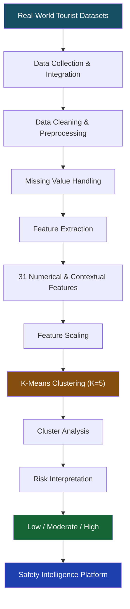
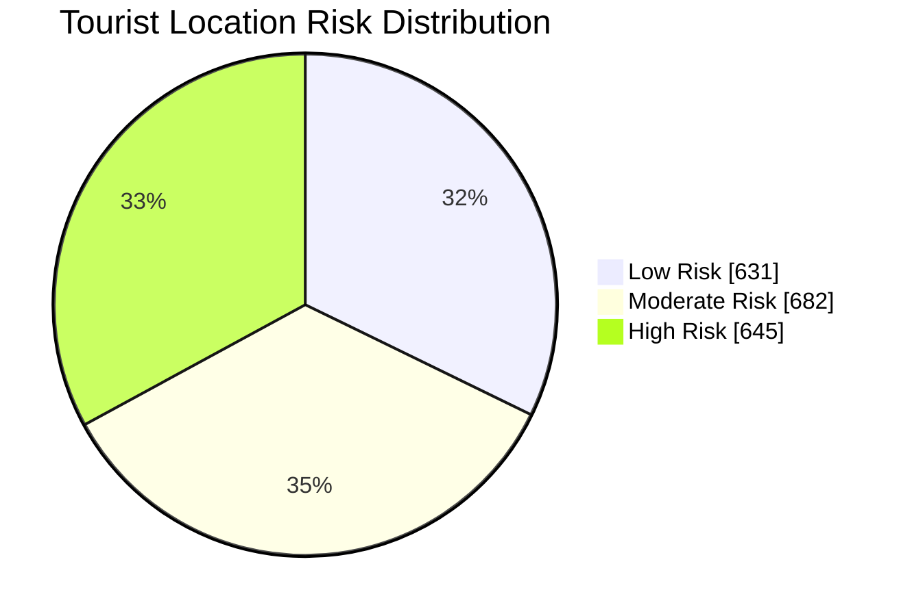
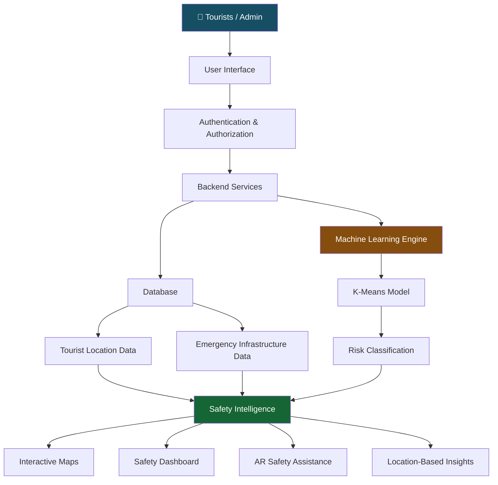

<div align="center">

# 🛡️ SAFEYATRI TN

### AI-POWERED TOURIST SAFETY & INTELLIGENCE PLATFORM

**Travel Safe. Explore Freely. Stay Protected.**

An intelligent, data-driven tourist safety ecosystem combining
Machine Learning, real-world geographical data, emergency infrastructure
mapping, and interactive safety intelligence to make tourism safer.

<br/>


<br/>

[Overview](#-overview) •
[Features](#-key-features) •
[Machine Learning](#-machine-learning-engine) •
[Dataset](#-dataset--analytics) •
[Architecture](#-system-architecture) •
[Installation](#-getting-started)

</div>

---

# 🌍 Overview

**SafeYatri TN** is an AI-powered tourist safety and intelligence platform designed to improve travel safety across all 38 districts of Tamil Nadu, India.

Traditional tourism platforms primarily focus on destinations and travel information. SafeYatri goes a step further by integrating Machine Learning-based risk assessment, geographical intelligence, and emergency infrastructure information into a unified safety ecosystem.

The platform analyzes tourist locations using real-world geographical and contextual datasets to identify potential vulnerability levels and provide tourists with meaningful safety insights.

### 💡 Our Mission

To transform conventional tourism into an intelligent, safety-focused experience where travellers can make informed decisions before and during their journeys.

<div align="center">

**Explore Smarter. Travel Safer.**

</div>

---

# 🎯 Problem Statement

Tourists visiting unfamiliar destinations may encounter several safety challenges:

- Lack of reliable information about destination safety.
- Difficulty locating nearby police stations and hospitals.
- Limited awareness of potentially vulnerable tourist locations.
- Fragmented emergency information across multiple platforms.
- Lack of intelligent, location-based safety assistance.
- Difficulty accessing relevant emergency infrastructure during unexpected situations.

### 🎯 Our Solution

SafeYatri addresses these challenges through a centralized tourist safety ecosystem that combines:

- Machine Learning-based location risk assessment.
- Real-world tourist and geographical datasets.
- Emergency facility mapping.
- Interactive safety dashboards.
- Location-aware safety assistance.
- Augmented Reality-based safety experiences.

---

# 📊 Project at a Glance

<div align="center">

| 📍 Metric | 📈 Statistics |
|:---|---:|
| Tourist Locations | **1,958** |
| Integrated Tourist Locations | **1,940** |
| Additional Seed Locations | **18** |
| Emergency Facilities | **10,164** |
| Numerical / Contextual Features | **31** |
| Total Dataset Columns | **39** |
| Machine Learning Algorithm | **K-Means** |
| Clustering Configuration | **K = 5** |
| Risk Categories | **3** |

</div>

---

# ✨ Key Features

## 🧠 01. AI-Based Tourist Risk Assessment

An intelligent Machine Learning component that analyzes tourist location characteristics to identify potential vulnerability patterns.

**Key Capabilities:**
- K-Means-based geographical and contextual clustering.
- Analysis of 31 numerical and contextual features.
- Identification of location similarity patterns.
- Risk interpretation into Low, Moderate, and High categories.
- Data-driven tourist safety insights.

## 📍 02. Real-World Tourist Location Intelligence

A geographical intelligence system built using real-world tourist location datasets.

**Key Capabilities:**
- Integrated tourist location information.
- Geographical coordinate analysis.
- Contextual feature extraction.
- Location-based safety assessment.
- Tourist destination information across Tamil Nadu.

## 🚨 03. Emergency Infrastructure Mapping

Helps tourists identify important emergency infrastructure around tourist destinations.

**Mapped Facilities:**

| Facility | Number of Records |
|:---|---:|
| 🏥 Hospitals | 5,460 |
| 🩺 PHCs / Clinics | 4,198 |
| 🚓 Police Stations | 445 |
| 🚒 Fire & Rescue | 60 |
| 🚑 Ambulance | 1 |
| **Total** | **10,164** |

## 👤 04. User & Admin Authentication

A role-based authentication system designed to provide separate access for tourists and administrators.

- Dedicated User and Admin login.
- Role-based access control.
- Backend authorization.
- Database-level Row-Level Security (RLS).
- Restricted access to sensitive application resources.

## 🥽 05. AR-Based Safety Assistance

An interactive Augmented Reality-based safety experience designed to improve tourist awareness.

- AR-based safety information.
- Interactive safety experiences.
- Enhanced situational awareness.
- Location-oriented safety assistance.

## 📊 06. Safety Intelligence Dashboard

A centralized dashboard that transforms geographical and analytical information into meaningful visual insights.

- Tourist location insights.
- Risk category distribution.
- Emergency infrastructure statistics.
- Data-driven safety visualizations.
- Location-based analytical information.

---

# 🧠 Machine Learning Engine

SafeYatri incorporates an **Unsupervised Machine Learning approach** to discover patterns and similarities among tourist locations.

### ⚙️ Algorithm: K-Means Clustering

K-Means is used to group tourist locations based on similarities across their numerical and contextual features without requiring predefined risk labels.

### 🔬 Machine Learning Workflow



### 📌 Implementation Steps

1. Collect and integrate real-world tourist location datasets.
2. Perform data cleaning and preprocessing.
3. Handle missing values.
4. Extract 31 numerical and contextual features.
5. Prepare and scale the relevant features.
6. Apply K-Means clustering with K = 5.
7. Analyze the resulting five clusters.
8. Interpret the clusters into three risk categories.
9. Integrate the resulting risk information into the SafeYatri platform.

### 🤔 Why K-Means?

K-Means helps discover patterns in geographical and contextual data by grouping similar tourist locations together.

Since predefined, verified risk labels are not available for every tourist location, an unsupervised learning approach provides a way to explore underlying location patterns.

> **Important:** The Low, Moderate, and High classifications represent clustering-based risk interpretations. They should not be treated as verified predictions of actual incidents or guaranteed measures of tourist safety.

---

# 📈 Dataset & Analytics

SafeYatri integrates real-world geographical and contextual information to build its tourist safety intelligence system.

### 📍 Tourist Location Dataset

| Dataset Metric | Value |
|:---|---:|
| Integrated Tourist Locations | 1,940 |
| Additional Seed Locations | 18 |
| **Total Tourist Locations** | **1,958** |
| Numerical / Contextual Features | 31 |
| Total Dataset Columns | 39 |

### 🚑 Emergency Infrastructure Dataset

| Facility Type | Count |
|:---|---:|
| Police Stations | 445 |
| Hospitals | 5,460 |
| PHCs / Clinics | 4,198 |
| Fire & Rescue | 60 |
| Ambulance | 1 |
| **Total** | **10,164** |

### 📊 ML-Based Risk Distribution

The K-Means model divides the 1,958 tourist locations into five clusters, which are subsequently interpreted into three risk categories.

| Risk Category | Tourist Locations |
|:---|---:|
| 🟢 Low Risk | 631 |
| 🟡 Moderate Risk | 682 |
| 🔴 High Risk | 645 |
| **Total** | **1,958** |

### 📉 Risk Distribution Visualization



---

# 🏗️ System Architecture

SafeYatri follows an integrated architecture connecting the user interface, authentication services, backend, database, Machine Learning engine, and safety intelligence components.



### 🔄 Architecture Components

| Layer | Responsibility |
|:---|:---|
| User Interface | Tourist and Admin interaction |
| Authentication | Identity and role management |
| Backend | Application logic and service coordination |
| Database | Tourist and emergency infrastructure records |
| ML Engine | Location clustering and risk interpretation |
| Safety Intelligence | Integrating analytical results into application features |
| Visualization | Maps, dashboards and AR safety experiences |

---

# 🛠️ Technology Stack

SafeYatri combines modern web technologies, geographical information processing, database management, and Machine Learning.

| Category | Technologies |
|:---|:---|
| Programming Language | Python, TypeScript, JavaScript |
| Machine Learning | Scikit-learn |
| Data Processing | Pandas, NumPy |
| ML Algorithm | K-Means Clustering |
| Frontend | React |
| Database | Project-configured Database |
| Backend | Project Backend Services |
| Version Control | Git, GitHub |
| Development Environment | Visual Studio Code |

---

# 📂 Project Structure

```text
SafeYatri/
│
├── project/
│   │
│   ├── src/
│   │   ├── data/
│   │   │   ├── touristSeed.ts
│   │   │   └── real-world/
│   │   │       └── safeyatri-real-world-data/
│   │   │           └── source_files/
│   │   │
│   │   ├── components/
│   │   ├── pages/
│   │   ├── services/
│   │   └── ...
│   │
│   ├── public/
│   ├── package.json
│   └── ...
│
├── README.md
└── ...
```

*This structure illustrates the major project directories. Individual folders may vary.*

---

# 🚀 Getting Started

Follow these instructions to set up SafeYatri locally.

### 1️⃣ Clone the Repository

```bash
git clone YOUR_GITHUB_REPOSITORY_URL
```

### 2️⃣ Navigate to the Project Directory

```bash
cd SafeYatri/project
```

### 3️⃣ Install Dependencies

```bash
npm install
```

### 4️⃣ Configure Environment Variables

Create a `.env` file inside the project directory.

Configure the required environment variables according to the project configuration.

Refer to `.env.example` for the expected configuration.

**Security Note:** Never commit your actual `.env` file or expose API keys and credentials.

### 5️⃣ Start the Development Server

```bash
npm run dev
```

Open the local development URL displayed in your terminal.

---

# 🔐 Security Considerations

SafeYatri incorporates security-oriented application practices:

- Role-based User and Admin access.
- Backend-side authorization checks.
- Database Row-Level Security (RLS).
- Environment variable protection.
- Restricted access to sensitive resources.

---

# 🌟 What Makes SafeYatri Different?

| Traditional Tourism Platforms | SafeYatri |
|:---|:---|
| Primarily destination-focused | Destination and safety-focused |
| Limited safety insights | ML-based risk intelligence |
| Separate emergency information | Integrated emergency infrastructure |
| General travel information | Location-based safety insights |
| Limited interactive safety features | AR-based safety experience |

SafeYatri brings geographical intelligence, Machine Learning, and emergency infrastructure information together in a unified tourism safety platform.

---

# 🔮 Future Enhancements

We aim to continuously improve SafeYatri through the following enhancements:

- 🌦️ Real-time environmental and weather-based risk monitoring.
- 🤖 AI-powered personalized safety recommendations.
- 🚨 Real-time emergency alert notifications.
- 🗺️ Advanced route safety analysis.
- 🌐 Multilingual tourist assistance.
- 🏥 Integration with live emergency response services.
- 🧠 Improved analytical models using continuously updated datasets.

---

# 🎯 Project Vision

We envision a smarter tourism ecosystem where technology and data work together to protect travellers.

SafeYatri aims to bring together intelligent risk assessment, real-world geographical information, emergency infrastructure, and interactive safety assistance into one unified platform.

<div align="center">

### 🛡️ SAFEYATRI TN

**Travel Safe. Explore Freely. Stay Protected.**

*Making every journey smarter, safer, and more informed.*

<br/>

**Built with ❤️ for a safer tourism experience.**

<br/>

⭐ **If you find SafeYatri interesting, consider giving this repository a star!**

</div>
