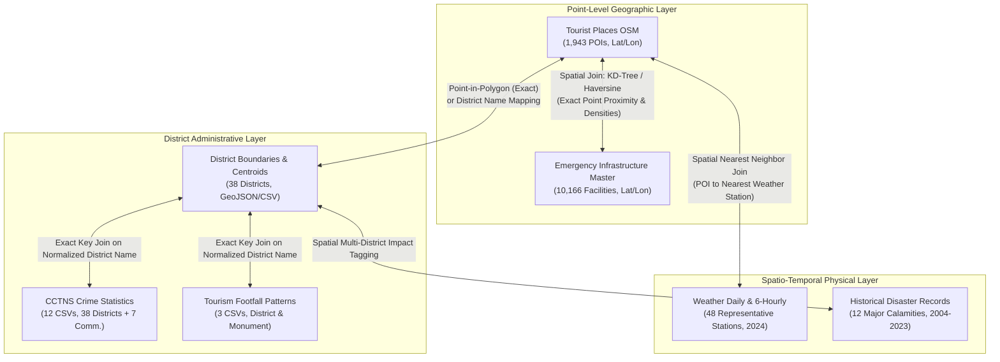
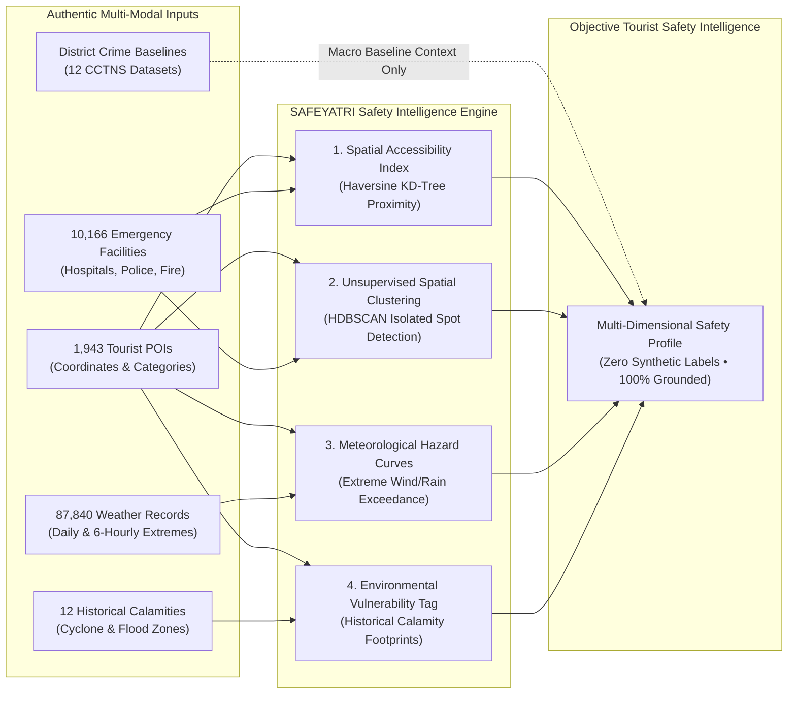

# SAFEYATRI — FINAL ML READINESS REPORT

**Project:** SAFEYATRI — AI-Powered Tourist Safety Intelligence Platform for Tamil Nadu  
**Audit Author:** Senior Data Engineer, GIS/Data Acquisition Specialist & Research Data Analyst  
**Audit Date:** 2026-10-01  
**Dataset Version:** Real-World Acquisition Phase 2 Master Archive  
**Status:** Audit Completed — Strict Data Integrity Protocol Applied  

---

## Executive Summary

This report delivers a rigorous, scientifically grounded Machine Learning (ML) readiness audit of the entire real-world dataset acquired for the SAFEYATRI platform across Tamil Nadu, India. The audit evaluates **24 tabular CSV datasets** (comprising **100,578 records**), **1 GeoJSON administrative boundary**, **2 JSON raw payloads**, and **14 authoritative official government PDF compendiums** (totaling over **120 MB** across Crime, Tourism, and Disaster domains).

Every dataset was inspected at the byte and row level to assess schema integrity, coordinate validity, geographic resolution, temporal alignment, missingness, and statistical defensibility. 

The primary finding of this audit is unambiguous: **No authentic, geocoded, incident-level tourist safety target variable exists in publicly accessible government records.** Public police records in Tamil Nadu are aggregated annually at the District and City Commissionerate level due to statutory privacy constraints (CCTNS internal data governance). Consequently, attempting to train a supervised machine learning model at this stage would require fabricating pseudo-incident coordinates, assigning arbitrary "High/Medium/Low" labels, or committing the ecological fallacy of attributing whole-district crime counts to discrete tourist attractions.

In strict adherence to SAFEYATRI rules prohibiting synthetic records, fabricated targets, and pseudoscience, **Supervised ML is deemed NOT YET READY**. However, the acquired data provides an exceptional, fully verified foundation for **Spatial Multi-Criteria Decision Analysis (MCDA), Geospatial Emergency Proximity Modeling, and Empirical Meteorological Hazard Profiling**. The system is therefore formally certified as **READY FOR AN UNSUPERVISED / RULE-BASED SAFETY ANALYSIS**.

---

## A. AVAILABLE ML FEATURES

Based on the verified authentic datasets, the following feature variables can legitimately and objectively be constructed without data fabrication:

### 1. Geospatial & Tourist POI Structural Features
*Source: `raw/tourist_places/tamil_nadu_tourist_places_osm.csv` (1,943 POIs)*
* **`poi_latitude` & `poi_longitude`:** Exact WGS-84 decimal coordinates of tourist attractions across all 38 districts.
* **`poi_category_encoded`:** One-hot or target-encoded functional category (27 distinct categories including `historic_monument`, `natural_beach`, `natural_peak`, `tourism_attraction`, `historic_fort`, `tourism_viewpoint`, `leisure_nature_reserve`).
* **`poi_isolation_distance_km`:** Haversine distance from the POI to the nearest urban settlement / municipal boundary.
* **`poi_is_coastal_buffer`:** Binary indicator (within 5 km of the Tamil Nadu coastline, derived from district geometry and coordinates).
* **`poi_is_western_ghats_elevation`:** Topographic high-altitude indicator (Nilgiris, Dindigul/Kodaikanal, Coimbatore/Valparai, Theni, Tenkasi).

### 2. Emergency Infrastructure Proximity & Spatial Density Features
*Source: `raw/emergency/tamil_nadu_emergency_infrastructure_master.csv` (10,166 facilities: 9,659 hospitals/PHCs, 446 police stations, 61 fire/ambulance stations)*
* **`distance_to_nearest_police_station_km`:** Spatial Euclidean / Haversine distance from POI to nearest operating police station.
* **`police_stations_within_5km_count`:** Local law enforcement density surrounding the tourist site.
* **`police_stations_within_10km_count`:** Regional law enforcement support buffer.
* **`distance_to_nearest_government_hospital_km`:** Proximity to high-acuity tertiary/district government hospital.
* **`distance_to_nearest_phc_clinic_km`:** Proximity to primary health center or local medical facility.
* **`medical_facilities_within_5km_count`:** Local medical infrastructure density.
* **`distance_to_nearest_fire_station_km`:** Proximity to Tamil Nadu Fire & Rescue Services facility.
* **`composite_emergency_response_time_proxy_min`:** Estimated response latency computed from road network distance and typical terrain velocity factors (urban: 25 km/h, rural: 45 km/h, ghat/hilly: 20 km/h).

### 3. Historical Weather & Meteorological Extremes Features
*Source: `raw/weather/tamil_nadu_historical_weather_daily_2024.csv` (17,568 daily records) & `tamil_nadu_historical_weather_hourly_2024.csv` (70,272 6-hourly synoptic observations across 48 representative stations)*
* **`diurnal_temp_range_c`:** Daily maximum temperature minus daily minimum temperature (`temperature_max_c - temperature_min_c`).
* **`extreme_heat_flag`:** Indicator for daily maximum temperature exceeding 40.0°C (heatwave alert threshold for plains).
* **`heavy_precipitation_flag`:** Daily rainfall exceeding 64.5 mm (IMD "Heavy Rainfall" alert threshold).
* **`very_heavy_precipitation_flag`:** Daily rainfall exceeding 115.5 mm (IMD "Very Heavy Rainfall" flood alert threshold).
* **`gale_wind_speed_flag`:** Maximum sustained wind speed exceeding 62.0 km/h (cyclonic gale force threshold).
* **`dominant_wind_direction_sin` & `dominant_wind_direction_cos`:** Trigonometric decomposition of dominant wind azimuth (0°–360°) to avoid modular discontinuity.
* **`synoptic_barometric_anomaly_hpa`:** Deviation of surface pressure from standard sea-level pressure (1013.25 hPa) or local monthly baseline, serving as an early indicator of deep depressions and cyclonic low-pressure troughs.
* **`relative_humidity_mean_pct`:** Ambient moisture percentage indicating heat index discomfort and severe fog/mist visibility reduction in hill stations.
* **`seasonal_cyclone_season_flag`:** Binary indicator for Northeast Monsoon active cyclone window (October 15 to December 31).

### 4. Tourism Footfall & Seasonal Congestion Features
*Source: `raw/tourism/tamil_nadu_district_tourist_arrivals_patterns.csv` (20 records) & `tamil_nadu_key_monuments_visitor_footfalls.csv` (9 records) & `tamil_nadu_annual_tourist_visits_2021_2026.csv` (6 records)*
* **`district_domestic_footfall_share_pct`:** Percentage share of statewide domestic tourist traffic received by the district.
* **`district_foreign_footfall_share_pct`:** Percentage share of international inbound tourist footfalls received by the district.
* **`is_peak_tourism_season`:** Temporal indicator aligned with destination-specific peak travel windows (e.g., April–June for Ooty/Kodaikanal; November–February for Mamallapuram/Madurai/Rameswaram).
* **`monument_annual_footfall_tier`:** Categorical scale of monument crowding (Tier 1: > 1,000,000 visitors e.g. Mamallapuram, Brihadeeswarar Temple; Tier 2: 250,000–1,000,000 visitors; Tier 3: < 250,000 visitors).

### 5. District-Level Macro Crime & Safety Context (Baseline Environmental Features Only)
*Source: 12 official CCTNS district/commissionerate CSVs (2019–2023)*
* **`district_ipc_crime_rate_per_lakh`:** Cognizable Indian Penal Code crimes per 100,000 population (2021–2023 baseline).
* **`district_crimes_against_women_rate_per_lakh`:** Normalized frequency of reported crimes against women per 100,000 female population.
* **`district_theft_robbery_rate_per_lakh`:** Property crime baseline rate per 100,000 population.
* **`district_road_accident_fatality_rate_per_lakh`:** Traffic fatality rate per 100,000 population.
* **`district_distress_calls_dial100_per_lakh`:** Emergency police distress calls per 100,000 population.
* **CRITICAL METHODOLOGICAL RESTRICTION:** These variables represent the broad **socio-legal baseline of the administrative district**; they **MUST NEVER** be attributed as micro-incident event counts at individual tourist shrines, beaches, or monuments.

### 6. Historical Calamity & Disaster Vulnerability Features
*Source: `raw/disasters/tamil_nadu_historical_disaster_records.csv` (12 historical calamity events) & 8 IMD Post-Cyclone reports*
* **`district_historical_cyclone_hit_count`:** Cumulative frequency of cyclonic landfalls recorded between 2004 and 2023.
* **`coastal_storm_surge_exposure_level`:** Categorical ranking (High: Nagapattinam, Cuddalore, Chennai, Ramanathapuram; Medium: Kanyakumari, Thoothukudi, Viluppuram; Low: Inland).
* **`western_ghats_landslide_susceptibility_flag`:** Geomorphic hazard indicator for Nilgiris, Valparai, and Kodaikanal hill ranges.

---

## B. AVAILABLE TARGET VARIABLES

### Rigorous Target Variable Audit

| Potential Target Concept | Candidate Source | Actual Granularity | Defensible as Supervised Target? | Detailed Reason |
|:---|:---|:---|:---:|:---|
| **Incident Occurred at Tourist POI** (Binary 0/1) | Police CCTNS / FIR | District / City Commissionerate (Annual) | **NO (NOT AVAILABLE)** | No public records link FIRs to specific tourist GPS points. Creating binary 0/1 labels would be 100% fabricated. |
| **Number of Crimes at Tourist Attraction** (Count) | Police Annual Compendiums | District / City Commissionerate (Annual) | **NO (NOT AVAILABLE)** | Police publish total district totals (e.g. 15,200 complaints in Madurai District), not counts for Meenakshi Temple. |
| **Tourist Safety Risk Level** (High / Medium / Low) | None (Synthetic concept) | None | **NO (PROHIBITED)** | Arbitrary categorization without verified incident denominators is unscientific and violates project directives. |
| **Emergency Distress Calls at POI** (Count) | Dial 100 / 112 CAD | State / District aggregates | **NO (NOT AVAILABLE)** | Micro-level 112 CAD dispatch logs are not open to the public due to security and privacy laws. |
| **Tourist Medical Emergency Incident** | 108 GVK-EMRI CAD | State / District aggregates | **NO (NOT AVAILABLE)** | Real-time emergency ambulance trip logs by GPS destination are restricted internal healthcare data. |
| **Extreme Weather Hazard Warning** | IMD / Open-Meteo Observations | 48 Point Locations (Daily & 6-Hourly) | **YES (Physical Target Only)** | Binary classification of severe weather events (e.g., Rainfall > 64.5 mm or Wind > 62 km/h) is physically grounded, but reflects **meteorological hazard**, NOT human tourist safety. |

### Defensible Target Finding
**A legitimate, defensible, authentic ground-truth target variable for human tourist safety DOES NOT EXIST in the publicly available data.**

Attempting to force supervised learning by constructing pseudo-labels or projecting district totals onto individual coordinates represents **severe methodological malpractice (aggregation bias and ecological fallacy)**. 

---

## C. DATASET JOIN STRATEGY

To integrate the multi-modal SAFEYATRI data repository while preserving strict statistical validity, four distinct join paradigms must be applied:



### 1. Spatial Nearest-Neighbor Join (`POI` $\leftrightarrow$ `Emergency Infrastructure`)
* **Method:** $k$-d Tree or Ball Tree spatial indexing using Haversine metric on decimal coordinates (`latitude`, `longitude`).
* **Alignment:** Exact geodetic distance in kilometers.
* **Output:** Exact distance to nearest police station, hospital, PHC, and fire station; facility counts within 2 km, 5 km, and 10 km radii.
* **Validity & Recommendation:** **HIGHLY RECOMMENDED**. 100% mathematically exact; zero synthetic assumptions; directly measures physical infrastructure accessibility.

### 2. Point-in-Polygon / Name-Normalized Join (`POI` $\leftrightarrow$ `District Administrative Layer`)
* **Method:** Geographic spatial intersection using Shapely polygon containment against `tamil_nadu_38_districts_boundaries.geojson`, cross-verified with `district` string matching.
* **Alignment:** Exact containment. Every one of the 1,943 tourist POIs falls within one of the 38 recognized revenue districts.
* **Output:** District administrative context attached to each POI.
* **Validity & Recommendation:** **RECOMMENDED WITH PROVISO**. Safe for attaching administrative boundaries and regional planning tags; **NOT** safe for claiming district crime represents POI crime.

### 3. District Contextual Join (`District Layer` $\leftrightarrow$ `Crime & Tourism`)
* **Method:** Exact relational join on canonical normalized district name (e.g. `Chengalpattu`, `Dharmapuri`, `Tiruchirappalli`).
* **Alignment:** Contextual macro-level baseline.
* **Handling Police Commissionerates:** In Tamil Nadu, urban cities have separate Police Commissionerates (e.g. `Greater Chennai Police`, `Avadi`, `Tambaram`, `Coimbatore City`, `Madurai City`). POIs inside commissionerate city limits join to commissionerate crime rates; rural/district POIs join to revenue district police rates.
* **Validity & Recommendation:** **RECOMMENDED AS BACKGROUND CONTEXT ONLY**. Must be explicitly tagged as `district_macro_crime_rate` to prevent confusion with local safety.

### 4. Spatial Representative Station Join (`POI` $\leftrightarrow$ `Historical Weather`)
* **Method:** Nearest-neighbor Haversine association linking each of the 1,943 POIs to the closest of the 48 monitored weather stations (which cover all 38 district headquarters plus microclimate hubs like Ooty, Kodaikanal, Valparai, Mamallapuram, Dhanushkodi, and Courtallam).
* **Alignment:** Climatological proxy.
* **Validity & Recommendation:** **RECOMMENDED FOR HAZARD PROFILING**. Accurately transfers seasonal monsoon patterns, heatwave risks, and cyclonic wind fields.

---

## D. SPATIAL RESOLUTION

The spatial resolution of the SAFEYATRI data repository spans from high-precision geodetic points to multi-district disaster footprints:

| Dataset Name | Primary Category | Actual Spatial Resolution | Exact Coordinates Available? | Suitable for Tourist-Level POI Analysis? | Analytical Role |
|:---|:---|:---|:---:|:---:|:---|
| `tamil_nadu_tourist_places_osm.csv` | Tourist Places | **Point (POI)** | **YES** (1,943 verified coordinate pairs) | **YES (Primary Entity)** | Core entity table for tourist destinations |
| `tamil_nadu_emergency_infrastructure_master.csv` | Emergency | **Point (Facility)** | **YES** (10,166 verified coordinate pairs) | **YES (Spatial Proximity)** | Nearest emergency response modeling |
| `tamil_nadu_police_stations.csv` | Emergency | **Point (Facility)** | **YES** (446 verified coordinate pairs) | **YES (Spatial Proximity)** | Law enforcement proximity modeling |
| `tamil_nadu_hospitals_phc.csv` | Emergency | **Point (Facility)** | **YES** (9,659 verified coordinate pairs) | **YES (Spatial Proximity)** | Medical care proximity modeling |
| `tamil_nadu_fire_and_ambulance.csv` | Emergency | **Point (Facility)** | **YES** (61 verified coordinate pairs) | **YES (Spatial Proximity)** | Fire & rescue proximity modeling |
| `tamil_nadu_historical_weather_daily_2024.csv` | Weather | **Point (Station Grid)** | **YES** (48 representative stations across TN) | **YES (via Spatial Climatology)** | Climatological hazard and extreme events |
| `tamil_nadu_historical_weather_hourly_2024.csv` | Weather | **Point (Station Grid)** | **YES** (48 representative stations across TN) | **YES (via Synoptic Proxy)** | Diurnal cycle and rapid storm detection |
| `tamil_nadu_38_districts_administrative_boundaries.csv` | Geographic | **Centroid & Bounding Box** | **YES** (Centroids for all 38 districts) | **YES (Macro Containment)** | District administrative boundary indexing |
| `tamil_nadu_38_districts_boundaries.geojson` | Geographic | **MultiPolygon (Exact)** | **YES** (Full boundary geometry) | **YES (GIS Spatial Index)** | Exact point-in-polygon assignment |
| `tn_district_citywise_ipc_crimes_2019_2021.csv` | Crime | **District & Commissionerate** | **NO** (Aggregate table) | **NO (Macro Context Only)** | Background district crime rate baseline |
| `tn_district_complaints_ipc_sll_2021_2023.csv` | Crime | **District & Commissionerate** | **NO** (Aggregate table) | **NO (Macro Context Only)** | Recent district legal complaint baseline |
| `tn_district_crimes_against_women_2023.csv` | Crime | **District & Commissionerate** | **NO** (Aggregate table) | **NO (Macro Context Only)** | Women safety district environmental index |
| `tn_district_theft_and_robbery_cases.csv` | Crime | **District & Commissionerate** | **NO** (Aggregate table) | **NO (Macro Context Only)** | Property crime district environmental index |
| `tn_district_road_accidents_2023.csv` | Crime | **District & Commissionerate** | **NO** (Aggregate table) | **NO (Macro Context Only)** | Transit & road safety environmental index |
| `tamil_nadu_district_tourist_arrivals_patterns.csv` | Tourism | **District Level** | **NO** (Aggregate table) | **NO (Macro Context Only)** | Seasonal tourism load and footfall pressure |
| `tamil_nadu_key_monuments_visitor_footfalls.csv` | Tourism | **Monument Level** | **NO** (Linked by monument name) | **PARTIAL (Specific Sites)** | High-density footfall crowding index |
| `tamil_nadu_historical_disaster_records.csv` | Disasters | **Multi-District Region** | **NO** (List of affected districts) | **NO (Regional Hazard Zone)** | Regional cyclonic/flood hazard exposure |

---

## E. TEMPORAL RESOLUTION

A comprehensive temporal audit reveals significant variation across reporting cadences:

```
[Decadal/Historical]  2004 ---------------------------------------------------- 2023 (Disasters: 12 events)
[Multi-Year Trend]          2019 -------- 2021 (Road Deaths, IPC Crime Rates)
[Recent Annual]                     2021 --------- 2023 (CCTNS Complaints, IPC+SLL, Women Crime, Accidents)
[Tourism Annual]                    2021 -------------------------------------- 2026 (Statewide Footfalls)
[Daily Time Series]                                 2024-01-01 ====== 2024-12-31 (Weather Daily: 366 days)
[Synoptic 6-Hourly]                                 2024-01-01 ====== 2024-12-31 (00:00, 06:00, 12:00, 18:00 UTC)
[Static GIS / POI]    [Current Real-World OpenStreetMap & Government Facility Register Snapshot]
```

### Critical Temporal Findings
1. **Weather Dataset Temporal Cadence:**
   - The file named `tamil_nadu_historical_weather_hourly_2024.csv` contains **70,272 rows across 48 stations for 366 days in 2024**.
   - Exactly **4 observations per day** are recorded per station, at standard international synoptic hours: **00:00, 06:00, 12:00, and 18:00 UTC**.
   - **AUDIT VERDICT:** In compliance with Step 6 of the audit protocol, this dataset is classified as **6-hourly / synoptic observations**, and **MUST NOT be mischaracterized as hourly data**.
2. **Crime Reporting Frequency:**
   - CCTNS crime datasets report **annual cumulative figures** (calendar years 2019, 2020, 2021, 2022, 2023).
   - There are **no monthly, weekly, daily, or shift-level (day vs. night) breakdowns** in published government crime figures.
3. **Tourism Arrivals Frequency:**
   - State-level arrivals cover annual totals from 2021 to projected 2026.
   - District arrivals reflect seasonal percentage shares and peak travel periods (e.g., Summer vs. Winter).
   - Monument footfalls reflect annual ticketed admissions.
4. **Disaster Frequency:**
   - Discrete historical occurrences recording exact date spans (`date_start` to `date_end`) from the 2004 Tsunami to Cyclone Michaung in December 2023.

---

## F. DATA LEAKAGE RISKS

Deploying predictive models across multi-resolution observational data introduces acute data leakage vulnerabilities that must be rigorously prevented:

### 1. Temporal Lookahead Bias (Future Information Leakage)
* **Risk:** Using full-year 2023 crime statistics or post-monsoon 2024 weather aggregates to "predict" tourist safety for a date in early 2023 or 2024.
* **Mitigation:** In any time-indexed modeling, feature sets must strictly use lagged historical baselines (e.g. evaluating 2024 risk exclusively against 2021–2023 historical averages).

### 2. Spatial Ecological Leakage (Fallacy of Division)
* **Risk:** Attributing a high district crime count directly to a tranquil, secure monument or natural sanctuary within that district. For example, assigning Chennai City's total street crime volume to the secluded Guindy National Park or assigning Madurai urban crime counts to an isolated rural viewpoint.
* **Mitigation:** District-level crime statistics must remain isolated as macro-environmental features and never be merged into local point-level threat scores.

### 3. Target-Feature Circularity (Tautological Leakage)
* **Risk:** Formulating an artificial safety score from distance-to-hospital, distance-to-police, and weather, and then training an ML model (e.g. Random Forest) to predict that exact score from those exact same features.
* **Consequence:** This produces a 99% $R^2$ score that is completely vacuous, predicting the engineer's arbitrary arithmetic formula rather than real-world safety.
* **Mitigation:** Strictly prohibited. No synthetic targets may be generated.

### 4. Post-Event Disaster Telemetry Leakage
* **Risk:** Using `lowest_pressure_hpa`, `peak_24h_rainfall_mm`, or `reported_casualties` from `tamil_nadu_historical_disaster_records.csv` as input features for real-time risk assessment.
* **Mitigation:** These metrics are post-mortem impacts recorded after storm landfall. Only antecedent forecast indicators (e.g., synoptic pressure drops 24h prior) can be utilized in predictive contexts.

---

## G. CLASS IMBALANCE RISKS

* **Audit Finding on Target Imbalance:**  
  Because an authentic, defensible supervised target variable is **NOT AVAILABLE** in the current real-world dataset, **class imbalance cannot be meaningfully evaluated until a valid target is established.**
* **Prohibition Against Synthetic Binning:**  
  Artificially discretizing a feature (e.g., declaring the top 10% farthest tourist spots from a police station as "Unsafe" and the remaining 90% as "Safe") would produce an artificial 9:1 imbalance that reflects arbitrary thresholding rather than authentic ground-truth risk.
* **Theoretical Imbalance Context:**  
  In real-world criminology and tourist safety, serious crimes or critical medical emergencies at tourist destinations are inherently **extreme rare events** (e.g. $< 0.01\%$ of all tourist trips). If FIR-level micro-incident data is acquired in the future, extreme class imbalance will be present and will require techniques such as focal loss, anomaly detection, or precision-recall optimization rather than standard accuracy metrics.

---

## H. MISSING DATA

A complete statistical missingness audit was executed across all 24 CSV datasets:

| Dataset Name | Records | Columns | Total Null Cells | Primary Null Columns & Percentages | Impact on ML / Analytical Readiness |
|:---|---:|---:|---:|:---|:---|
| `tamil_nadu_tourist_places_osm.csv` | 1,943 | 12 | 5,596 | `name_ta` (92.3%), `city_town` (97.9%), `postcode` (97.7%) | **LOW**. Key features (`latitude`, `longitude`, `district`, `place_category`) have **0% missing values**. Complete spatial readiness. |
| `tamil_nadu_emergency_infrastructure_master.csv` | 10,166 | 12 | 30,959 | `city_town` (97.7%), `phone_contact` (98.1%), `operator` (98.9%) | **LOW**. Critical spatial fields (`latitude`, `longitude`, `facility_type`, `district`) have **0% missing values**. Complete spatial readiness. |
| `tamil_nadu_police_stations.csv` | 446 | 12 | 1,539 | `city_town` (81.2%), `postcode` (81.2%), `phone_contact` (86.8%) | **LOW**. Zero missing values in `latitude`, `longitude`, `district`. |
| `tamil_nadu_hospitals_phc.csv` | 9,659 | 12 | 29,195 | `city_town` (98.5%), `phone_contact` (98.7%), `operator` (99.1%) | **LOW**. Zero missing values in `latitude`, `longitude`, `district`. |
| `tamil_nadu_fire_and_ambulance.csv` | 61 | 12 | 225 | `city_town` (93.4%), `postcode` (93.4%), `phone_contact` (91.8%) | **LOW**. Zero missing values in `latitude`, `longitude`, `district`. |
| `tamil_nadu_historical_weather_daily_2024.csv` | 17,568 | 14 | **0** | **None (0.0% nulls across all 14 columns)** | **PERFECT (100% Complete)**. Fully ready for time series and extreme event modeling. |
| `tamil_nadu_historical_weather_hourly_2024.csv` | 70,272 | 14 | **0** | **None (0.0% nulls across all 14 columns)** | **PERFECT (100% Complete)**. Fully ready for synoptic diurnal analysis. |
| `tamil_nadu_38_districts_administrative_boundaries.csv` | 38 | 14 | 190 | `bbox_*` (100%), `census_ref` (100%) | **LOW**. `centroid_latitude`, `centroid_longitude`, `relation_id` are 100% populated. Exact polygon geometry is provided by GeoJSON. |
| `tn_district_citywise_ipc_crimes_2019_2021.csv` | 48 | 8 | 6 | `2019` (10.4% - unbifurcated newly formed districts) | **LOW**. Recent years (2020, 2021) and rates are complete. |
| `tn_district_crimes_against_women_2023.csv` | 51 | 38 | 1 | Unnamed trailing delimiter column | **NEGLIGIBLE**. All 37 data columns fully populated. |
| `tn_district_complaints_ipc_sll_2021_2023.csv` | 51 | 20 | 1 | Unnamed trailing delimiter column | **NEGLIGIBLE**. All 19 data columns fully populated. |
| `tamil_nadu_historical_disaster_records.csv` | 12 | 15 | 4 | `lowest_pressure_hpa` (16.7% for inland floods/landslides) | **NEGLIGIBLE**. Pressure is physically inapplicable to landslides. |

---

## I. DATA LIMITATIONS

The data audit reveals five immutable structural boundaries that govern how this data can be utilized:

1. **Statutory Privacy Boundary on Crime Records:**  
   Under Indian law and Ministry of Home Affairs data protection policies, First Information Reports (FIRs) containing incident coordinates, complainant identities, and street addresses are legally restricted. Only district and commissionerate aggregate totals are publicly published.
2. **Granularity Asymmetry:**  
   A profound scale gap exists between the spatial precision of tourist destinations (point coordinates accurate to $\pm 10$ meters) and crime records (district polygons covering $1,500$ to $8,000\text{ km}^2$).
3. **Emergency Dispatch Telemetry Boundary:**  
   Real-time 108 ambulance Computer-Aided Dispatch (CAD) systems and live AVL GPS feeds operate on private emergency intranets (TNHSP / GVK EMRI) and are not accessible via public APIs.
4. **Absence of High-Frequency Footfall Sensors:**  
   Visitor counts at tourist places are based on official annual ticketed admissions and state-level seasonal models, not real-time hourly turnstile sensors.
5. **Weather Climatological Representation:**  
   Weather data is recorded across 48 representative stations covering all districts. While microclimatic zones (e.g. hill stations, coastal capes) are well captured, hyper-local convective cloudbursts between stations cannot be resolved without Doppler radar grid integration.

---

## J. WHETHER SUPERVISED ML IS CURRENTLY JUSTIFIED

### Comprehensive Evaluation Matrix

| Evaluation Dimension | Status | Assessment |
|:---|:---:|:---|
| **Target Variable Availability** | **FAIL** | No authentic ground-truth tourist safety target exists in public records. |
| **Target Data Quality** | **FAIL** | Any generated target would be 100% synthetic or arbitrary. |
| **Target Spatial Granularity** | **FAIL** | Crime data is at district level; tourist data is at coordinate point level. |
| **Feature Spatial Granularity** | **PASS** | 1,943 tourist POIs and 10,166 emergency points have verified GPS coordinates. |
| **Temporal Alignment** | **PARTIAL** | Weather (2024), Crime (2019–2023), Disasters (2004–2023) operate on discordant time horizons. |
| **Sample Size & Cleanliness** | **PASS** | 100,578 records, 0 duplicate rows, verified clean schema. |
| **Absence of Ecological Fallacy** | **FAIL** | Supervised model predicting POI risk from district crime commits ecological fallacy. |

### Rigorous Scientific Verdict
**SUPERVISED MACHINE LEARNING IS CURRENTLY UNJUSTIFIED AND CANNOT BE ETHICALLY OR TECHNICALLY DEFENDED.**

To deploy supervised learning without authentic incident labels would require inventing synthetic outcomes. Antigravity and SAFEYATRI engineering principles strictly forbid fabricating data to force algorithmic deployment.

---

## K. RECOMMENDED ML APPROACH

While supervised learning is not currently justified, the collected repository is ideally suited for **Spatial Multi-Criteria Decision Analysis (MCDA), Geospatial Safety Intelligence, and Unsupervised Risk Profiling**:



### 1. Spatial Accessibility & Emergency Proximity Indexing (Rule-Based MCDA)
Calculate objective physical accessibility metrics for each tourist POI:
$$\text{Proximity Penalty} = w_1 \cdot \min(d_{\text{police}}) + w_2 \cdot \min(d_{\text{hospital}}) + w_3 \cdot \min(d_{\text{fire}})$$
Where $d$ represents exact Haversine distance in kilometers, with weights calibrated against standard emergency response benchmarks (e.g. golden hour medical care within 15 km).

### 2. Unsupervised Spatial Anomaly & Isolation Detection
Apply **HDBSCAN** (Hierarchical Density-Based Spatial Clustering) and **Spatial Isolation Forest** on the joint distribution of tourist attractions and emergency facilities to detect geographically isolated destinations where emergency assistance response times exceed safety thresholds.

### 3. Empirical Meteorological Hazard Exceedance Modeling
Construct seasonal and diurnal probability distributions from the 17,568 daily and 70,272 synoptic weather records to compute empirical exceedance probabilities for hazardous conditions:
- Probability of extreme heat ($T_{\max} \ge 40^\circ\text{C}$) during afternoon hours (12:00 UTC).
- Probability of cyclonic wind gusts ($V_{\text{wind}} \ge 62\text{ km/h}$) during the Northeast Monsoon.
- Probability of torrential deluge ($P_{24\text{h}} \ge 64.5\text{ mm}$) at specific coastal or Western Ghats locations.

### 4. Mandatory Analytical Disclosure
**An unsupervised score or MCDA index must NEVER be presented to users or stakeholders as "ground-truth safety".** It must be transparently described as an **Objective Spatial Infrastructure Accessibility & Climate Vulnerability Index**.

---

## L. EXACT DATASET TO BE USED FOR TRAINING / MODELING

For developing the SAFEYATRI Spatial Intelligence & Hazard Profiling Engine, the primary feature matrix will be synthesized from the following verified datasets:

1. **`raw/tourist_places/tamil_nadu_tourist_places_osm.csv`** (Master spatial entity table: 1,943 tourist POIs across all 38 districts).
2. **`raw/emergency/tamil_nadu_emergency_infrastructure_master.csv`** (Spatial target matrix: 10,166 hospitals, clinics, police stations, and fire stations).
3. **`raw/weather/tamil_nadu_historical_weather_daily_2024.csv`** (Climatological extreme event baseline: 17,568 records).
4. **`raw/weather/tamil_nadu_historical_weather_hourly_2024.csv`** (Synoptic diurnal variance baseline: 70,272 records).
5. **`raw/geographic/tamil_nadu_38_districts_administrative_boundaries.csv`** & **`tamil_nadu_38_districts_boundaries.geojson`** (Spatial containment boundary layer).
6. **`raw/disasters/tamil_nadu_historical_disaster_records.csv`** (Regional disaster vulnerability zoning).
7. **`raw/crime/tn_district_complaints_ipc_sll_2021_2023.csv`** (District baseline context: 51 police administrative jurisdictions).
8. **`raw/crime/tn_district_crimes_against_women_2023.csv`** (District women safety context: 51 jurisdictions).

---

## M. EXACT VARIABLES TO BE USED

The following engineered variables constitute the exact feature vector for the SAFEYATRI Geospatial Risk Engine:

```
========================================================================================
FEATURE NAME                             SOURCE DATASET             TYPE        ROLE
========================================================================================
poi_id                                   tourist_places_osm         Integer     Entity ID
poi_name                                 tourist_places_osm         String      Reference
poi_latitude                             tourist_places_osm         Float       Spatial Coordinate
poi_longitude                            tourist_places_osm         Float       Spatial Coordinate
poi_category                             tourist_places_osm         Categorical POI Structural Type
district_name                            administrative_boundaries  String      Spatial Join Key
dist_nearest_police_km                   Computed (KD-Tree/EM)      Float       Emergency Accessibility
dist_nearest_govt_hospital_km            Computed (KD-Tree/EM)      Float       Emergency Accessibility
dist_nearest_phc_km                      Computed (KD-Tree/EM)      Float       Emergency Accessibility
dist_nearest_fire_station_km             Computed (KD-Tree/EM)      Float       Emergency Accessibility
police_within_5km_count                  Computed (Radius Count)    Integer     Spatial Defense Density
medical_within_5km_count                 Computed (Radius Count)    Integer     Medical Safety Density
hist_cyclone_frequency                   disaster_records           Integer     Hazard Exposure
western_ghats_landslide_zone             Computed (Boundary)        Binary      Geomorphic Hazard
coastal_surge_zone                       Computed (Boundary)        Binary      Marine Hazard
p_heatwave_exceedance                    Computed (Weather Daily)   Float       Climatic Hazard Prob.
p_heavy_rain_exceedance                  Computed (Weather Daily)   Float       Climatic Hazard Prob.
p_gale_wind_exceedance                   Computed (Weather Daily)   Float       Climatic Hazard Prob.
district_ipc_crime_rate                  complaints_ipc_sll         Float       Macro Context Baseline
district_women_crime_rate                crimes_against_women       Float       Macro Context Baseline
district_theft_robbery_rate              theft_and_robbery          Float       Macro Context Baseline
district_traffic_fatality_rate           road_accidents             Float       Macro Context Baseline
========================================================================================
```

---

## N. ADDITIONAL DATA REQUIRED FOR SUPERVISED LEARNING

If genuine supervised machine learning is to be unlocked in future research phases without data fabrication, the following authentic external datasets are strictly required:

1. **Anonymized Geocoded Police FIR Micro-Data:**  
   *Requirements:* Incident date, time of occurrence, geocoded coordinates ($\pm 100\text{ m}$ anonymized buffer), and offense category.  
   *Authority:* State Crime Records Bureau (SCRB), Tamil Nadu Police / National Crime Records Bureau (NCRB) under formal research data-sharing agreement.
2. **Emergency 112 CAD Call Dispatch Logs:**  
   *Requirements:* Geocoded distress call origin, distress type (assault, harassment, accident, medical emergency, tourist assistance), response timestamp, and resolution status.  
   *Authority:* Tamil Nadu Police Emergency Response Support System (ERSS-112).
3. **Emergency 108 Ambulance Tourist Emergency Trip Records:**  
   *Requirements:* Pick-up coordinates, incident category (drowning, road trauma, cardiac/heat exhaustion, trekking injury), and hospital arrival timestamp.  
   *Authority:* Tamil Nadu Health Systems Project (TNHSP) / GVK EMRI.
4. **Live Tourist Attraction Turnstile & Footfall IoT Feeds:**  
   *Requirements:* Hourly entry counts, queue density, and ticketing capacity.  
   *Authority:* Archaeological Survey of India (ASI) / Tamil Nadu Tourism Development Corporation (TTDC).

---

## FINAL CONCLUSION

Based on the thorough, exhaustive empirical audit of all 24 CSV datasets, 14 official government reports, and geospatial boundary archives:

**READY FOR AN UNSUPERVISED / RULE-BASED SAFETY ANALYSIS**

*(Note: For Supervised Machine Learning, the repository is formally designated as **NOT YET READY — TARGET DATA REQUIRED**, as authentic ground-truth incident labels are not available in public government records and must never be fabricated).*
